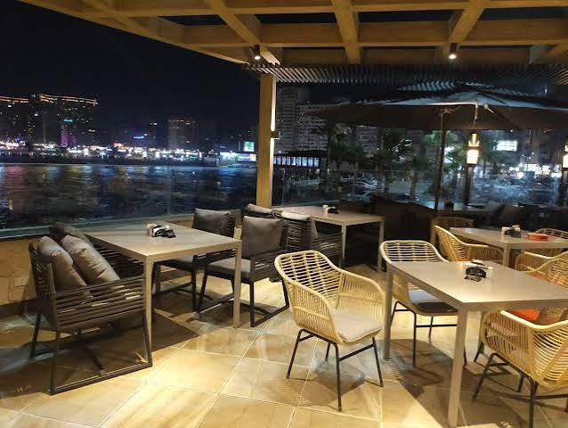

# My Favorite Café



**My Favorite Café** is a university web-development assignment that presents a fictional café called **Harbor & Roast** with a warm, waterfront-inspired menu and design.

> [!NOTE]
> The café name, description, menu items, prices, and location references are fictional. They were used only to demonstrate the assignment requirements.

## Project Overview

This project was developed for the **Web Programming I (IT303)** course in the **Information Technology Department** at **Borg Al Arab Technological University**. It applies fundamental HTML5 and CSS concepts through a centered café menu page.

| Detail | Information |
| --- | --- |
| Project | My Favorite Café |
| Course | Web Programming I |
| Course Code | IT303 |
| Department | Information Technology |
| Academic Year | 2nd Year |
| Semester | Spring 2026 |
| Lecturer | Assoc. Prof. Ashraf Abdelaziz Taha |
| Submission Date | November 23, 2026 |

## Features

- Semantic HTML structure with a `header`, `main`, image, and menu table
- A uniquely identified main heading using `#main-title`
- A styled `<div>` container with padding, borders, width, and rounded corners
- A highlighted word in the introduction using `<span>`
- A café image with `src`, `alt`, `width`, and `height`
- A clearly formatted café menu built with `<table>`, `<tr>`, `<th>`, and `<td>`
- An external location link that opens in a new browser tab
- Custom external CSS using warm beige and brown colors
- Hover effects for the image and location link
- A card-based layout that adapts to different screen widths

## Technologies

- HTML5
- CSS3

No frameworks, libraries, or build tools are required.

## Assignment Requirements

This submission represents **Solution 2: External CSS**.

| Requirement | Status |
| --- | --- |
| Heading with `id="main-title"` | Completed |
| `<div class="box">` with padding, border, and margin-related layout styling | Completed |
| `<span>` used inside a paragraph | Completed |
| `` with `src`, `alt`, `width`, and `height` | Completed |
| Menu table using `<table>`, `<tr>`, `<th>`, and `<td>` | Completed |
| External link using `target="_blank"` | Completed |
| External CSS file | Completed |
| Image named `cafe.jpg` in the project folder | Completed |

## Project Structure

```text
MyFavoriteCafe/
├── MyFavoriteCafe.html
├── MyFavoriteCafe.css
├── MyFavoriteCafe.md
└── cafe.jpg
```

| File | Purpose |
| --- | --- |
| `MyFavoriteCafe.html` | Defines the page content and HTML structure |
| `MyFavoriteCafe.css` | Provides all page styling and hover effects |
| `cafe.jpg` | Displays the café image |
| `MyFavoriteCafe.md` | Project documentation |

## How to Run

1. Clone the repository:

   ```bash
   git clone https://github.com/emariem394-ship-it/University_Projects.git
   ```

2. Open the project folder:

   ```bash
   cd University_Projects/MyFavoriteCafe
   ```

3. Open `MyFavoriteCafe.html` in a web browser.

No installation or server is required.

## Screenshot


The image is used as a visual preview within the page. The repository does not include a complete browser screenshot.

## Learning Outcomes

Through this assignment, I practiced:

- Writing accessible and semantic HTML
- Creating and styling HTML tables
- Connecting an external stylesheet
- Using CSS boxes, borders, colors, spacing, and rounded corners
- Positioning page elements with Flexbox
- Adding image alt text and accessibility-oriented table attributes
- Creating hover and active states
- Building a polished layout from basic HTML and CSS concepts
- Using AI tools to support design and implementation while reviewing and completing the project independently

## Credits and Image Notice

- The project structure and page content were created for the **My Favorite Café** university assignment.
- The visual design was refined with AI assistance.
- `cafe.jpg` was found through a normal Google search and selected for use in this project.
- The original author and license for `cafe.jpg` were not retained. It should not be treated as verified for commercial use until the image source and usage rights are confirmed.

## Author

**Mariem Elsayed Mansour Ali Mousa**

GitHub: [emariem394-ship-it](https://github.com/emariem394-ship-it)

## Repository

[University Projects](https://github.com/emariem394-ship-it/University_Projects.git)